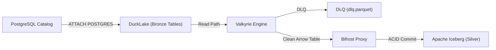

# Valkyrie Data Contract Engine

**Valkyrie** là động cơ kiểm định và cưỡng chế Hợp đồng Dữ liệu (Data Contract Enforcement Engine) nhúng thế hệ mới, được thiết kế chuyên biệt cho hệ sinh thái Data Lakehouse (Yggdrasil).

Valkyrie vận hành như một **DuckDB SQL Single-Pass Compiler**: biên dịch các hợp đồng kỹ thuật YAML (No-Fluff) thành câu lệnh SQL CTEs vector hóa duy nhất, loại bỏ hoàn toàn việc đọc đĩa 2 lần của chiến thuật Anti-Join truyền thống, tự động chọn chiến lược thực thi Out-of-Core (`TEMPORARY VIEW` vs `TEMPORARY TABLE`) để xử lý dữ liệu hàng trăm triệu dòng không lo OOM và tự động cấu hình Cloud Storage (S3/MinIO).

---

## Tính Năng Cốt Lõi

- **100% Executable Contract (Zero-Fluff)**: Bác bỏ văn xuôi định tính. Chỉ giữ lại Schema, Constraints, Custom Rules và `owner` giải trình.
- **Single-Pass Evaluation**: Duyệt dữ liệu đúng 1 lần từ đĩa/bộ nhớ, tiết kiệm 50% I/O và tăng gấp đôi tốc độ xử lý so với Anti-Join.
- **Adaptive Execution Strategy**: Tự động chọn `TEMPORARY TABLE` trong RAM cho phân tích tương tác (Jupyter) và `TEMPORARY VIEW` cho pipeline Out-of-Core quy mô lớn.
- **Zero-Boilerplate S3/MinIO**: Tự động đọc biến môi trường AWS/MinIO và cấu hình DuckDB Secret không cần code thủ công.
- **Circuit Breaker**: Cầu dao tự ngắt bảo vệ Data Lakehouse khi tỷ lệ lỗi vượt ngưỡng hoặc gặp chế độ `FAIL_FAST`.
- **Zero-Pydantic Architecture**: 100% parse bằng thư viện chuẩn `@dataclass`, loại bỏ rủi ro xung đột version trong container Airflow.

---

## Cài Đặt

```bash
pip install -e .
```

Yêu cầu phụ thuộc tối giản: chỉ cần `duckdb`, `pyarrow`, và `pyyaml`.

---

## Bắt Đầu Nhanh

### 1. Viết Contract (`contract.yaml`)

```yaml
version: "v1"
dataset: "sales"
owner: "sales-engineering@valkyrie.local"
policies:
  strict_schema: true
  max_error_rate: 0.05
  quarantine_action: "DLQ"
schema:
  - name: "sales_id"
    type: "BIGINT"
    not_null: true
    unique: true
  - name: "quantity"
    type: "INTEGER"
    not_null: true
    range: [1, 100]
  - name: "discount"
    type: "DOUBLE"
    range: [0.0, 0.5]
custom_rules:
  - name: "valid_sales"
    expression: "quantity >= 1 AND discount >= 0.0"
    error_code: "ERR_SALES_INTEGRITY"
```

### 2. Sử Dụng Trong Python

#### A. Phân tích tương tác trong Jupyter:
```python
import valkyrie

# Tự động chọn TABLE để lấy Arrow Table siêu tốc trong RAM
clean_arrow, dlq_arrow = valkyrie.run(
    sql="SELECT * FROM 'sales.parquet'",
    contract="contract.yaml"
)
```

#### B. Pipeline ETL Big Data (Out-of-Core Streaming):
```python
import valkyrie

# Tự động chọn VIEW để stream trực tiếp sang Parquet (Zero-OOM)
result = valkyrie.execute(
    sql="SELECT * FROM 's3://bronze/sales/*.parquet'",
    contract="contract.yaml",
    write_clean="s3://silver/sales/clean.parquet",
    write_dlq="s3://dlq/sales/dlq.parquet"
)
print(f"Xử lý {result.metrics['total_rows']:,} dòng trong {result.metrics['duration_ms']} ms")
```

#### C. Ghi Bảng Apache Iceberg Silver (DuckLake Bronze -> Valkyrie -> Bifrost Proxy):
```python
import duckdb
import valkyrie
from pyiceberg.catalog import load_catalog

# 1. Kết nối DuckDB và ATTACH PostgreSQL catalog của DuckLake
con = duckdb.connect()
con.execute("INSTALL postgres; LOAD postgres;")
con.execute("""
    ATTACH 'dbname=ducklake_catalog user=postgres password=postgres host=postgres-catalog port=5432' 
    AS ducklake (TYPE POSTGRES);
""")

# 2. Valkyrie đọc dữ liệu Bronze từ DuckLake catalog và thẩm định hợp đồng
clean_arrow, dlq_arrow = valkyrie.run(
    sql="SELECT * FROM ducklake.bronze_sales",
    contract="contract.yaml",
    connection=con,
    write_dlq="s3://lakehouse-dlq/sales/dlq.parquet"
)

# 3. Ghi ACID Append vào Apache Iceberg tầng Silver qua Bifrost Proxy
if clean_arrow and clean_arrow.num_rows > 0:
    catalog = load_catalog(
        "bifrost_catalog",
        **{
            "uri": "http://bifrost-proxy:8181",
            "warehouse": "s3://lakehouse-silver/warehouse",
            "s3.endpoint": "http://minio:9000"
        }
    )
    silver_table = catalog.load_table("silver.sales")
    silver_table.append(clean_arrow)
```



---

## Lộ Trình Phát Triển (Roadmap)

- [x] DuckDB SQL Single-Pass Vectorized Compiler (`to_sql`).
- [x] Adaptive Execution Strategy (`TEMPORARY VIEW` cho Big Data Streaming, `TEMPORARY TABLE` cho Interactive RAM).
- [x] Zero-Boilerplate Cloud Storage (AWS S3 & MinIO auto secrets).
- [x] Circuit Breaker & UTF-8 Diagnostic Banner (`ContractBreachException`).
- [ ] **Roadmap v0.2+**: Hỗ trợ tùy chọn ghi trực tiếp vào Iceberg REST Catalog (`write_iceberg_table="silver.orders"`, `catalog="bifrost"`) thông qua Lazy Import để hoàn thiện 1-line pipeline khép kín.

---

## Tài Liệu Chi Tiết

* 📖 **[Cẩm Nang Kỹ Sư Dữ Liệu (DE Guide)](docs/DE_GUIDE.md)**: Hướng dẫn chi tiết cú pháp viết contract, các trường ràng buộc, và cách vận hành trong từng môi trường (Jupyter, Airflow, S3/MinIO, CLI, Iceberg/Bifrost, Circuit Breaker).
* 🏛️ **[Tài Liệu Quyết Định Kiến Trúc (ADR-0001)](docs/adr/0001-valkyrie-duckdb-sql-contract-engine.md)**: Lý do thiết kế DuckDB SQL Single-Pass Compiler và loại bỏ Anti-Join.
* 📚 **[Thuật Ngữ Hệ Thống (GLOSSARY.md)](GLOSSARY.md)**: Định nghĩa chuẩn xác các khái niệm Clean Data, Dead-Letter Queue (DLQ), Strict Schema, Pre-flight check.
